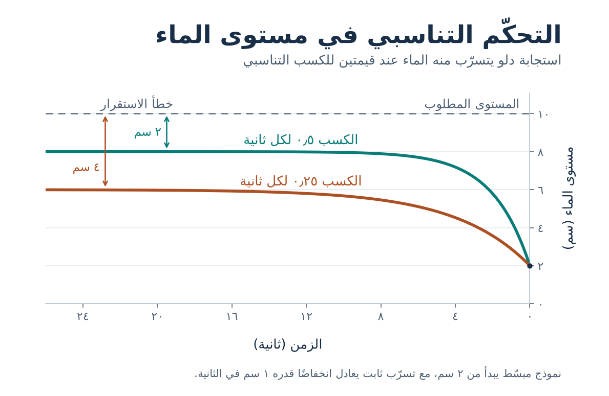

# Arabic SciPlot — الرسم العلمي بالعربية

حزمة صغيرة لتنسيق عناوين الرسوم البيانية ومحاورها وتدريجاتها بالعربية باستخدام **Matplotlib**، مع أدوات رقمية يمكن استعمالها في **Plotly**.

## التثبيت

تتطلب الحزمة بايثون 3.11 أو أحدث وMatplotlib 3.11 أو أحدث.

للتثبيت من PyPI:

```bash
pip install arabic-sciplot
```

للتجربة من المستودع:

```bash
pip install -e .
```

ولتشغيل أمثلة Plotly وB-spline الاختيارية: `pip install -e ".[examples]"`.

## الاستعمال

### مثال ثنائي الأبعاد (Matplotlib)

يوضّح المثال استجابة مستوى الماء في دلو ذي تسرّب ثابت عند قيمتين لكسب المتحكّم التناسبي. يبدأ الزمن من ٠ على اليمين ويزداد نحو اليسار. تبدأ المنحنيات عند ٢ سم على اليمين، ثم ترتفع نحو اليسار إلى مستويي الاستقرار ٨ سم و٦ سم. يزداد المحور الرأسي من أسفل إلى أعلى.



أبقِ إحداثيات البيانات بترتيبها الأصلي، واضبط اتجاه العرض باستخدام `invert_x=True`. يطبّق Matplotlib هذا الاتجاه على التدريجات والمنحنيات والنقاط والتعليقات المثبّتة بإحداثيات البيانات. يحوّل `FuncFormatter` في المثال التدريجات إلى الأرقام ٠–٩.

احفظ الشيفرة وشغّلها بعد التثبيت. سينشئ المثال `p-controller-arabic.png` في مجلد العمل الحالي. يستخدم الرسم خط «Noto Sans Arabic» عند توفّره، مع «DejaVu Sans» خطًا احتياطيًا.

```python
import matplotlib

matplotlib.use("Agg")

import matplotlib.pyplot as plt
from matplotlib.ticker import FuncFormatter
import numpy as np

from arabic_sciplot import arabic_2d_axis_formatter


target = 10.0  # cm
initial_level = 2.0  # cm
leak_rate = 1.0  # cm/s, equivalent rate of fall with the tap shut
time = np.linspace(0.0, 26.0, 521)

navy = "#192e47"
muted = "#4d6074"
teal = "#087c78"
rust = "#ac5023"
plt.rcParams.update({
    "font.family": ["Noto Sans Arabic", "DejaVu Sans"],
    "text.color": navy,
    "axes.labelcolor": navy,
    "xtick.color": muted,
    "ytick.color": muted,
})

fig, ax = plt.subplots(figsize=(8.2, 5.35), facecolor="white")
fig.subplots_adjust(left=0.075, right=0.87, bottom=0.233, top=0.765)

ax.set(xlim=(0, 26), ylim=(0, 11.1))
ax.set_xticks(np.arange(0, 25, 4))
ax.set_yticks(np.arange(0, 11, 2))
arabic_2d_axis_formatter(
    ax, invert_x=True, y_on_right=True,
    tick_direction="out", tick_length=4, tick_labelsize=11,
)
arabic_digits = str.maketrans("0123456789", "٠١٢٣٤٥٦٧٨٩")
for axis in (ax.xaxis, ax.yaxis):
    axis.set_major_formatter(
        FuncFormatter(lambda value, _: f"{value:.0f}".translate(arabic_digits))
    )
ax.set_xlabel("الزمن (ثانية)", fontsize=13)
ax.xaxis.set_label_coords(0.5, -0.165)
ax.set_ylabel("مستوى الماء (سم)", fontsize=13, labelpad=12)

ax.set_axisbelow(True)
ax.grid(axis="y", color="#e3e9ee", linewidth=0.8)
ax.spines[["top", "left"]].set_visible(False)
ax.spines[["right", "bottom"]].set_color("#b6c3cf")
ax.axhline(target, color="#65768a", linestyle=(0, (5, 4)), linewidth=1.35, zorder=2)
ax.text(0.55, 10.14, "المستوى المطلوب",
        ha="right", va="bottom", color=muted, fontsize=12)
ax.text(21.1, 10.14, "خطأ الاستقرار",
        ha="center", va="bottom", color=muted, fontsize=12)

for gain, gain_label, color, arrow_x, label_y, error_label in (
    (0.50, "الكسب ٠٫٥ لكل ثانية", teal, 19.5, 9.0, "٢ سم"),
    (0.25, "الكسب ٠٫٢٥ لكل ثانية", rust, 22.8, 7.15, "٤ سم"),
):
    equilibrium = target - leak_rate / gain
    level = equilibrium + (initial_level - equilibrium) * np.exp(-gain * time)

    ax.plot(time, level, color=color, linewidth=2.8, zorder=3)
    label_x = 12.3
    curve_y = np.interp(label_x, time, level)
    ax.text(label_x, curve_y + 0.24, gain_label,
            color=color, fontsize=13, va="bottom", ha="center")

    arrow_level = float(np.interp(arrow_x, time, level))
    ax.annotate("", xy=(arrow_x, arrow_level), xytext=(arrow_x, target),
                arrowprops={"arrowstyle": "<->", "color": color, "lw": 1.3,
                            "shrinkA": 2, "shrinkB": 3})
    ax.text(arrow_x + 0.3, label_y, error_label,
            ha="right", va="center", color=color, fontsize=11.5)

ax.scatter([0], [initial_level], color=navy, s=17, zorder=4, clip_on=False)
fig.text(0.922, 0.915, "التحكّم التناسبي في مستوى الماء",
         ha="right", va="center", fontsize=24, fontweight="bold")
fig.text(0.922, 0.845, "استجابة دلو يتسرّب منه الماء عند قيمتين للكسب التناسبي",
         ha="right", va="center", fontsize=13, color=muted)
fig.text(0.922, 0.058,
         "نموذج مبسّط يبدأ من ٢ سم، مع تسرّب ثابت يعادل انخفاضًا قدره ١ سم في الثانية.",
         ha="right", va="center", fontsize=10.5, color=muted)

fig.savefig("p-controller-arabic.png", dpi=300)
```

التوابع المتاحة: `arab`، `custom_formatter`، `custom_log_formatter`، `pi_formatter`، `generate_tickvals_and_text`، `arabic_2d_axis_formatter`، `arabic_3d_axis_formatter`، و`arabic_3d_plot_formatter`.

عندما يتطلّب الرسم محورًا أفقيًا يزداد من اليسار إلى اليمين، مرّر `invert_x=False`. ويمكن اختيار موضع المحور الرأسي وتعديل نمط التدريجات أيضًا.

```python
arabic_2d_axis_formatter(ax, invert_x=False, y_on_right=False,
                         tick_direction="out", tick_length=4, tick_labelsize=12)
```

### مثال ثلاثي الأبعاد (Matplotlib)

```python
import numpy as np
import matplotlib.pyplot as plt
from arabic_sciplot import arabic_3d_axis_formatter

t = np.linspace(0, 4 * np.pi, 300)
fig = plt.figure()
ax = fig.add_subplot(111, projection="3d")
ax.plot(np.cos(t), np.sin(t), t)
arabic_3d_axis_formatter(ax)
ax.set_title("منحنى حلزوني ثلاثي الأبعاد")
plt.show()
```

### مثال تدريجات رياضية (Plotly — تبعية اختيارية)

للتشغيل: `pip install "arabic-sciplot[plotly]"` من PyPI، أو `pip install -e ".[plotly]"` من المستودع.

```python
import numpy as np
import plotly.graph_objects as go
from arabic_sciplot import generate_tickvals_and_text

x = np.linspace(-np.pi, np.pi, 100)
tickvals, ticktext = generate_tickvals_and_text(
    x, num_ticks=5, use_pi_format=True
)
fig = go.Figure()
fig.add_scatter(x=x, y=np.sin(x))
fig.update_xaxes(title="س", tickvals=tickvals, ticktext=ticktext)
fig.show()
```

## اتجاه الكتابة والخطوط

أضاف **Matplotlib 3.11** دعم تشكيل الحروف العربية وترتيب الكتابة من اليمين إلى اليسار. لذلك يعيد `arab(text)` النص نفسه دون تغييره، ولم نعد نستخدم `arabic-reshaper` أو `python-bidi`. **لا تُمرّر نصًا مُعاد تشكيله مسبقًا** إلى Matplotlib الجديد؛ فقد ينعكس ترتيبه مرتين.

يجب توفر خط يدعم المحارف المطلوبة، مثل **DejaVu Sans** للحروف الشائعة، أو **Amiri** أو **Noto Naskh Arabic** لبعض النصوص والتشكيل. لا تُضمّن الحزمة خطوطًا ولا تفرض خطًا على المستخدم. يمكن تعيين خط مثبت لديك عبر `plt.rcParams["font.family"] = "Amiri"`. يعتمد العرض النهائي على الخط ومحرك الرسم.

تُبقي الدوال الإعدادات القديمة للمحاور: قلب المحور السيني، ونقل تدريجات الصادات إلى اليمين في الرسم الثنائي، وقلب المحورين الأفقيين في الرسم الثلاثي.

## أمثلة

- [`examples/basic_2d.py`](https://github.com/Pontmousse/arabic-sciplot/blob/main/examples/basic_2d.py) — استجابة المتحكّم التناسبي من اليمين إلى اليسار.
- [`examples/plot_3d.py`](examples/plot_3d.py) — رسم حلزوني ثلاثي الأبعاد.
- [`examples/plotly_ticks.py`](examples/plotly_ticks.py) — تدريجات رياضية عربية في Plotly (إضافي).
- [`examples/vector_field.py`](examples/vector_field.py) — حقل متجهات مأخوذ من [الموسوعة العربية](https://github.com/Pontmousse/alalbab/blob/main/resources/calculus/vector_calculus/curl2d.py).
- [`examples/spline_animation.py`](examples/spline_animation.py) — منحنى B-spline متحرك من [الموسوعة العربية](https://github.com/Pontmousse/alalbab/blob/main/resources/geometry/splines/bsplines/bspline.py)؛ ينشئ ملف GIF ويحتاج SciPy وPillow.

## الترخيص

MIT — انظر `LICENSE`.

## للمطورين ووكلاء الذكاء الاصطناعي

- [خارطة التطوير وتغطية أنواع الرسوم](docs/ROADMAP.md).
- [دليل الوكيل لإنشاء الرسوم العلمية بالعربية](https://github.com/Pontmousse/arabic-sciplot/blob/main/docs/AI_AGENT_GUIDE.md).
- [تعليمات مختصرة لوكلاء البرمجة](AGENTS.md).
